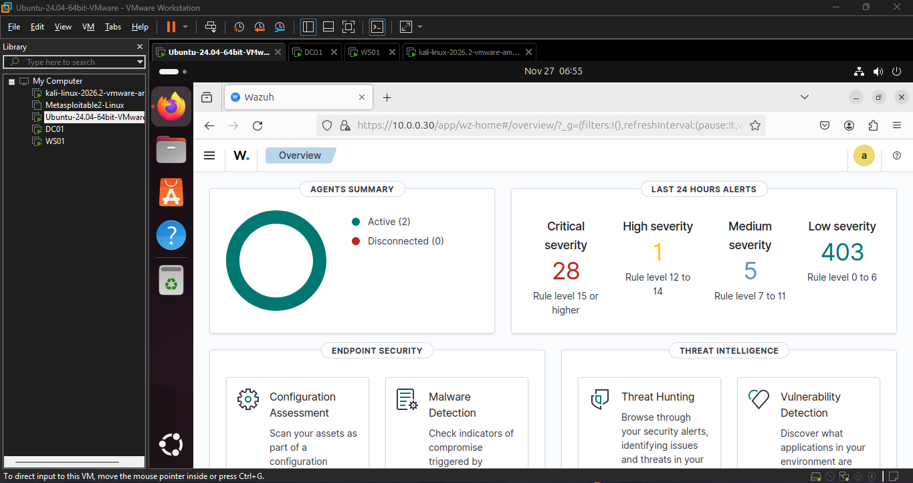
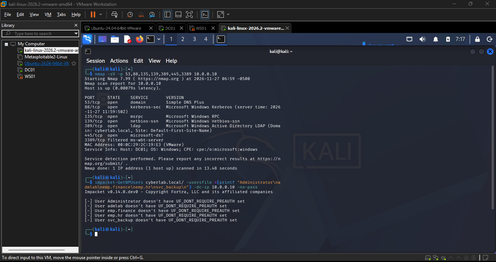
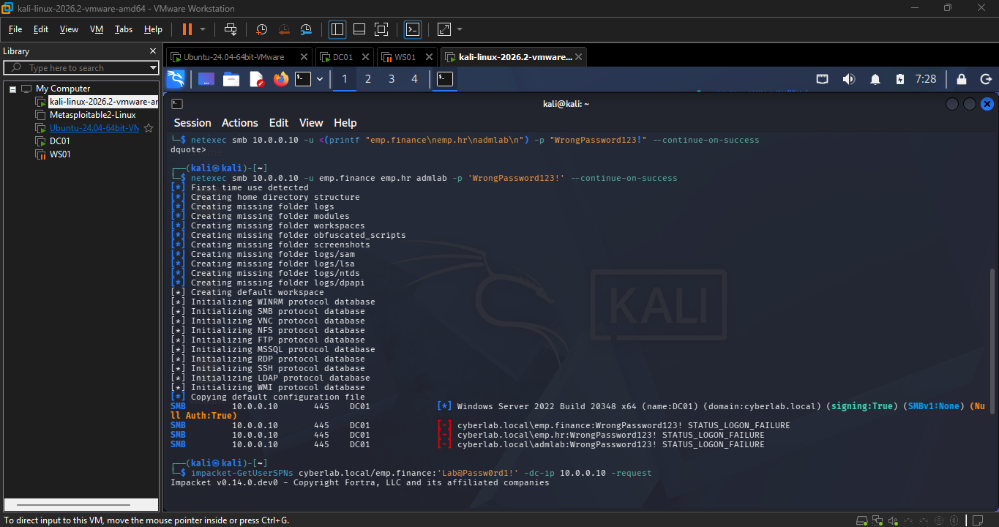
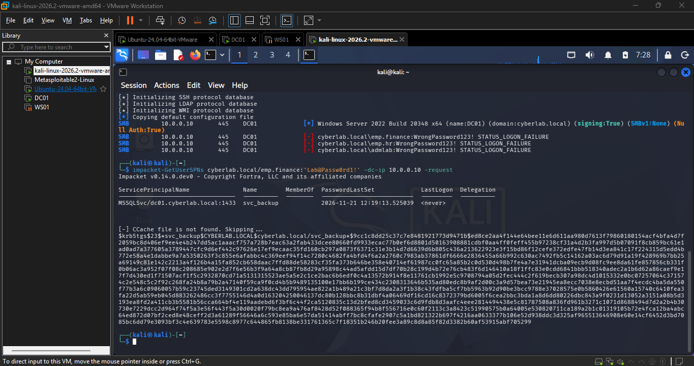
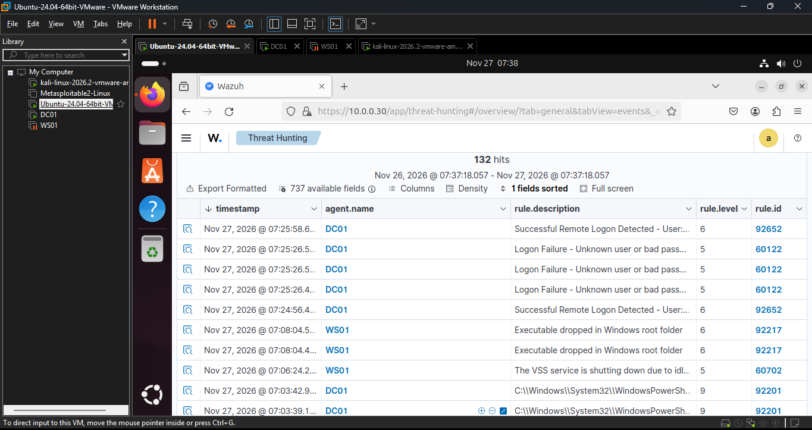

# 🛡️ Enterprise Active Directory & Wazuh SIEM Security Lab

An isolated, enterprise-grade Active Directory security lab designed to simulate realistic red-team attacks and demonstrate real-time blue-team threat detection, log correlation, and incident analysis using **Wazuh SIEM 4.11.2** and **Sysmon**.

---

## 🏗️ Lab Architecture & Network Topology

All virtual machines operate inside an isolated host-only virtual network (**`VMnet1` — `10.0.0.0/24`**) to ensure complete containment of attack traffic.

| Hostname | Operating System | IP Address | Role & Security Configuration |
| :--- | :--- | :--- | :--- |
| **`DC01`** | Windows Server 2022 | `10.0.0.10` | **Domain Controller & DNS (`cyberlab.local`)** — Hosts Organizational Units (OUs), domain users, SPN service account (`svc_backup`), Wazuh Agent, and Sysmon. |
| **`WS01`** | Windows 10 Pro | `10.0.0.20` | **Domain-Joined Workstation** — Simulates standard employee activity (`CYBERLAB\emp.finance`), monitored via Wazuh Agent and Sysmon. |
| **`Wazuh-SIEM`** | Ubuntu Server 24.04 | `10.0.0.30` | **Centralized SIEM Server (Wazuh 4.11.2)** — Collects, indexes, and correlates Windows Security & Sysmon event logs. |
| **`Kali-Attacker`** | Kali Linux 2026.2 | `10.0.0.50` | **Red Team Node** — Executes reconnaissance, credential spraying, and Kerberoasting attacks. |

---

## ⚙️ Defensive Setup & Telemetry Pipeline

1. **Active Directory Hardening & Structure (`DC01`):**
   * Configured domain **`cyberlab.local`** with segmented Organizational Units (`IT`, `Finance`, `HR`, `Service Accounts`, `Workstations`).
   * Applied **Least Privilege** principles across standard user accounts (`emp.finance`, `emp.hr`) and configured a realistic SPN-linked service account (`MSSQLSvc/dc01.cyberlab.local:1433` on `svc_backup`).
2. **Endpoint Visibility (`Wazuh Agent` + `Sysmon`):**
   * Deployed **Wazuh Agents** on both `DC01` and `WS01` reporting to `10.0.0.30`.
   * Installed **Sysmon64** with the **SwiftOnSecurity** configuration and integrated `Microsoft-Windows-Sysmon/Operational` into [`ossec.conf`](configs/sysmon-ossec-snippet.xml).

---

## ⚔️ Attack Scenarios & SIEM Detection Analysis

### 1. Network Reconnaissance & AS-REP Roasting Check
* **MITRE ATT&CK:** `T1046` (Network Service Discovery) & `T1558.004` (AS-REP Roasting)
* **Execution:** Scanned core Active Directory ports (`53, 88, 135, 139, 389, 445`) via `nmap` and enumerated domain accounts using `impacket-GetNPUsers`.
* **Result:** Identified active AD services and verified that Kerberos Pre-Authentication (`UF_DONT_REQUIRE_PREAUTH`) is properly enforced across all domain users.

---

### 2. SMB Password Spraying
* **MITRE ATT&CK:** `T1110.003` (Brute Force: Password Spraying)
* **Execution:** Tested a single common password (`WrongPassword123!`) across multiple domain accounts (`emp.finance`, `emp.hr`, `admlab`) using `netexec smb`.
* **SIEM Detection:** Triggered consecutive **Logon Failure (`Rule ID 60122` / `Event ID 4625`)** alerts on `DC01`, pinpointing attacker IP **`10.0.0.50`**.
* **Mitigation:** Enforce strict Account Lockout Policies via Group Policy (GPO) and alert on multiple `4625`/`4771` events originating from a single source IP within a short time window.

---

### 3. Kerberoasting Attack (`svc_backup`)
* **MITRE ATT&CK:** `T1558.003` (Steal or Forge Kerberos Tickets: Kerberoasting)
* **Execution:** Authenticated as low-privileged user `emp.finance` and requested a Kerberos Service Ticket (`TGS`) for `svc_backup` via `impacket-GetUserSPNs`, successfully extracting the crackable `$krb5tgs$23$` RC4 hash.
* **SIEM Detection:** Captured **Successful Remote Logon (`Rule ID 92652`)** and **Kerberos Service Ticket Request (`Event ID 4769`)** on `DC01` showing RC4 encryption (`0x17`) requested by `emp.finance` from `10.0.0.50` for `svc_backup`.
* **Mitigation:** Enforce 25+ character random passwords for service accounts, migrate to **Group Managed Service Accounts (gMSA)**, and disable legacy RC4 encryption in favor of **AES-256**.

---

### 4. Real-Time SOC Alert Correlation (`Wazuh Threat Hunting`)
All attack stages—from credential spraying (`Rule 60122`) and remote authentication (`Rule 92652`) to Sysmon process monitoring (`Rules 92201, 92217`)—were captured and correlated in real time on the Wazuh SIEM dashboard.

---

## 📌 Key Takeaways
* Combining native **Windows Security Auditing** with **Sysmon** telemetry provides full visibility across both authentication attacks (`4625`, `4769`, `4771`) and endpoint process execution.
* Structured alert correlation in **Wazuh SIEM** enables rapid attribution of attacker source IPs (`10.0.0.50`) and targeted high-value accounts (`svc_backup`, `admlab`).

## 📊 Governance, Risk & Compliance (GRC) Assessment

To bridge technical SOC operations with enterprise risk management, the findings from this lab were evaluated against industry-standard security frameworks (**NIST CSF**, **ISO/IEC 27001:2022**, and **CIS Controls v8**).

### 1. Risk Register & Severity Evaluation

| Identified Risk | Vulnerability / Attack Vector | Likelihood | Impact | Overall Risk Rating | Recommended Remediation & Control |
| :--- | :--- | :---: | :---: | :---: | :--- |
| **Weak Service Account Authentication** | Kerberoasting (`T1558.003`) via RC4-encrypted SPN ticket (`svc_backup`) | High | Critical | **Critical** | Migrate to **gMSA**, enforce 25+ char passwords, and disable RC4 in favor of AES-256. |
| **Credential Guessing Exposure** | SMB Password Spraying (`T1110.003`) against domain accounts | High | High | **High** | Enforce strict GPO Account Lockout Policies and implement MFA on privileged/remote access. |
| **Lateral Movement & Endpoint Execution** | Unmonitored script/binary execution on endpoints (`WS01`) | Medium | High | **High** | Enforce AppLocker/WDAC policies and maintain continuous Sysmon + SIEM alerting. |

---

### 2. Compliance & Control Mapping

| Attack / Defensive Capability | NIST CSF 2.0 | ISO/IEC 27001:2022 | CIS Controls v8 | Compliance Status & Lab Outcome |
| :--- | :--- | :--- | :--- | :--- |
| **Centralized Log Collection & SIEM (`Wazuh` + `Sysmon`)** | `DE.CM-01` / `DE.AE-02` | `A.8.15` (Logging) & `A.8.16` (Monitoring) | Control 8 (Audit Log Management) | **Compliant** — Real-time ingestion and correlation of `4625`, `4769`, and Sysmon events. |
| **Least Privilege & OU Segmentation (`cyberlab.local`)** | `PR.AA-05` | `A.5.15` (Access Control) & `A.8.2` (Privileged Access) | Control 5 & 6 (Account & Access Control) | **Compliant** — Standard users separated from administrative and service OUs. |
| **Kerberos Pre-Authentication Enforcement** | `PR.AA-01` | `A.8.5` (Secure Authentication) | Control 16 / Kerberos Hardening | **Compliant** — Verified `UF_DONT_REQUIRE_PREAUTH` disabled across all accounts. |
| **Service Account Encryption Hardening (RC4 vs. AES)** | `PR.DS-01` | `A.8.24` (Use of Cryptography) | Control 3 & 4 (Secure Configuration) | **Remediation Required** — RC4 (`0x17`) allowed TGS extraction; flagged for AES-256 upgrade. |
